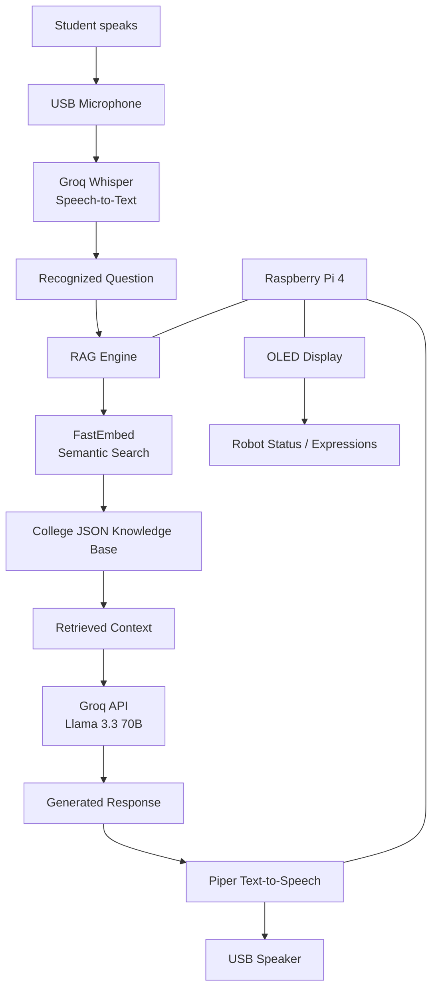

# RoboMate: Smart Campus Assistant Robot

A voice-enabled smart campus assistant designed to help students access college information through natural language conversations. RoboMate combines speech recognition, Large Language Models (LLMs), and Retrieval-Augmented Generation (RAG) in a Raspberry Pi-based robotic platform.

## Overview

RoboMate is a desk-based assistant robot developed for the Vidyavardhaka College of Engineering (VVCE) campus. It allows students to ask questions about college facilities, departments, faculty, campus locations, and other institutional information using voice commands.

The system follows a hybrid edge-cloud architecture: speech recognition and language generation are powered by Groq-hosted AI models, while knowledge retrieval, text-to-speech, and hardware interaction run locally on the Raspberry Pi.

## Key Features

- **Voice interaction:** Accepts spoken questions through a USB microphone.
- **Speech recognition:** Uses Groq Whisper (`whisper-large-v3`) to transcribe speech.
- **LLM-powered responses:** Uses Llama 3.3 70B Versatile through the Groq API.
- **Retrieval-Augmented Generation:** Retrieves relevant information from a curated college knowledge base before generating campus-specific responses.
- **Semantic search:** Uses FastEmbed with `sentence-transformers/all-MiniLM-L6-v2` for local text embeddings.
- **Text-to-speech:** Uses Piper for locally generated spoken responses.
- **OLED interface:** Displays robot expressions through an SH1106 OLED display.
- **Custom hardware:** Built around a Raspberry Pi 4 Model B with a custom 3D-printed enclosure.

## System Architecture



The architecture uses a hybrid edge-cloud approach:

- **Cloud processing:** Groq-hosted Whisper handles speech recognition, while Groq-hosted Llama 3.3 70B generates responses.
- **Local processing:** FastEmbed performs semantic embedding and retrieval against the college knowledge base. Piper handles speech synthesis, while the Raspberry Pi manages the OLED display and hardware interaction.

## Technology Stack

| Component | Technology |
|---|---|
| Main programming language | Python |
| Hardware platform | Raspberry Pi 4 Model B (4 GB) |
| Speech recognition | Groq Whisper Large v3 |
| Language model | Llama 3.3 70B Versatile |
| AI API platform | Groq |
| Embedding model | `sentence-transformers/all-MiniLM-L6-v2` |
| Embedding runtime | FastEmbed / ONNX Runtime |
| Retrieval | Semantic similarity search |
| Knowledge storage | JSON |
| Text-to-speech | Piper |
| OLED display | SH1106 |
| Display libraries | luma.oled, luma.core |
| Audio input | USB microphone |
| Audio output | USB speaker |

## Hardware Components

- Raspberry Pi 4 Model B (4 GB RAM)
- SH1106 OLED display
- USB microphone
- Wired USB speaker
- 5V, 3A Raspberry Pi power supply
- 32 GB microSD card
- Custom-designed and 3D-printed robot enclosure

## Project Structure

```text
RoboMate/
│
├── college/
│   ├── college_handler.py
│   ├── college_history.json
│   ├── facilities.json
│   ├── faculty.json
│   ├── fees.json
│   ├── general_info.json
│   ├── hostel.json
│   ├── locations.json
│   ├── policies.json
│   ├── robot_info.json
│   └── sports.json
│
├── config/
├── core/
├── llm/
├── modes/                   # experimental modes
│
├── voice/
│   ├── __init__.py
│   ├── stt_groq.py
│   ├── stt_vosk.py          # experimental (offline STT)
│   └── tts_piper.py
│
├── eyes.py                  # experimental OLED eye animations
├── groq_handler.py
├── main.py                  # testing entry point
├── oled_display.py
├── rag_engine.py
├── robot_daemon.py          # primary entry point
├── robot_eyes_simulator.py  # experimental (desktop simulator)
├── test_oled.py             # OLED test script
├── .env.example
├── .gitignore
├── requirements.txt
└── README.md
```

`robot_daemon.py` is the primary continuous-mode application entry point. The repository also contains experimental and alternative modules developed during the project.

## Getting Started

### Prerequisites

- Raspberry Pi 4 or a compatible Linux development environment
- Python environment compatible with the project dependencies
- Internet connectivity for Groq API services
- Groq API key
- USB microphone and speaker
- SH1106 OLED display for the hardware interface
- Piper runtime and its voice model for local speech synthesis

### 1. Clone the repository

```bash
git clone https://github.com/Aims04/RoboMate.git
cd RoboMate
```

### 2. Create a virtual environment

```bash
python -m venv venv
```

Activate it:

**Linux / Raspberry Pi OS**

```bash
source venv/bin/activate
```

**Windows PowerShell**

```powershell
.\venv\Scripts\Activate.ps1
```

### 3. Install Python dependencies

```bash
pip install -r requirements.txt
```

### 4. Set the Groq API key

The primary application (`robot_daemon.py`) reads the key from the `GROQ_API_KEY` environment variable and stops with an error if it is missing. Set it in the same terminal before you run the program.

**Linux / Raspberry Pi OS**

```bash
export GROQ_API_KEY="your_groq_api_key"
```

**Windows PowerShell**

```powershell
$env:GROQ_API_KEY="your_groq_api_key"
```

Never commit API keys or credentials to GitHub.

### 5. Install Piper

The Piper executable and voice model are distributed separately from this repository.

Install the Piper runtime and download the `en_US-lessac-medium` voice model for your platform. Place the files in the paths expected by the application:

```text
piper/
├── piper                        # Linux executable
├── en_US-lessac-medium.onnx
└── en_US-lessac-medium.onnx.json
```

On Linux, make sure the executable has permission to run.

The primary deployment target is Raspberry Pi OS/Linux. Windows execution may require adjusting the executable path in the application to use `piper.exe`.

### 6. Run RoboMate

```bash
python robot_daemon.py
```

The application initializes the robot components and enters continuous conversation mode.

**Note:** Hardware-specific components such as the OLED display, microphone, speaker, and Piper runtime must be configured for the target device. Groq speech recognition and LLM responses require an internet connection and valid API credentials.

## Research Publication

The project is also documented in the following research preprint:

**Design and Implementation of Indoor Autonomous Robot for Smart Campuses using RAG Architecture**

- Authors: Aiman Shariff, Bhargav P Yellambalse, Mohammed Junaid Ameen Pasha, Mukesh U, Dr. Nithin Kumar
- Year: 2026
- DOI: [10.5281/ZENODO.23976893](https://doi.org/10.5281/ZENODO.23976893)
- Preprint: [View on Zenodo](https://zenodo.org/records/23976893)

## Development Notes

- The current primary application uses Groq-hosted Whisper and Llama models.
- Semantic retrieval and the college knowledge base are handled locally.
- Piper provides local text-to-speech.
- API credentials and large model/runtime files are intentionally excluded from version control.
- The repository includes experimental modules and alternative implementations from the development process; these should not be confused with the primary application pipeline.

## Team

RoboMate was developed as a team capstone project at Vidyavardhaka College of Engineering.

**Contributors**

- Aiman Shariff (Project Leader)
- Bhargav P Yellambalse
- Mohammed Junaid Ameen Pasha
- Mukesh U
- Dr. Nithin Kumar (Project Guide)

## Acknowledgements

Developed as part of the undergraduate Computer Science and Engineering capstone project at Vidyavardhaka College of Engineering (VVCE), Mysuru.

---

*RoboMate: Making campus information accessible through conversational AI.*
